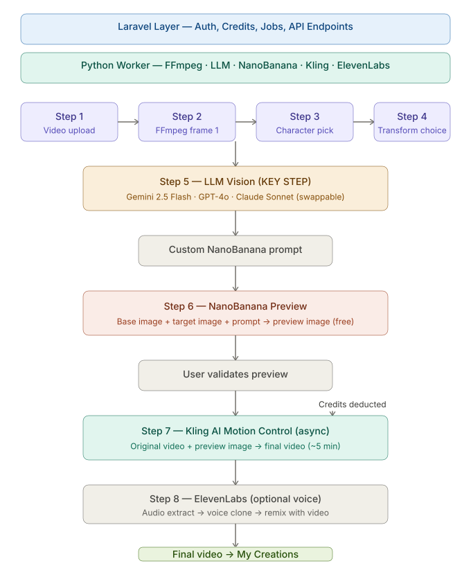
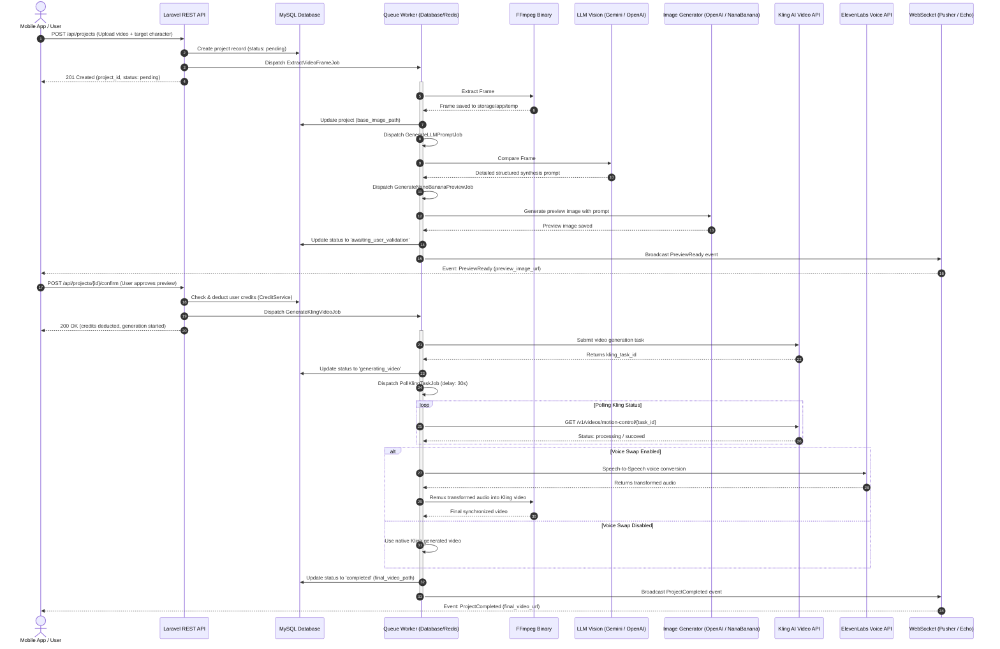
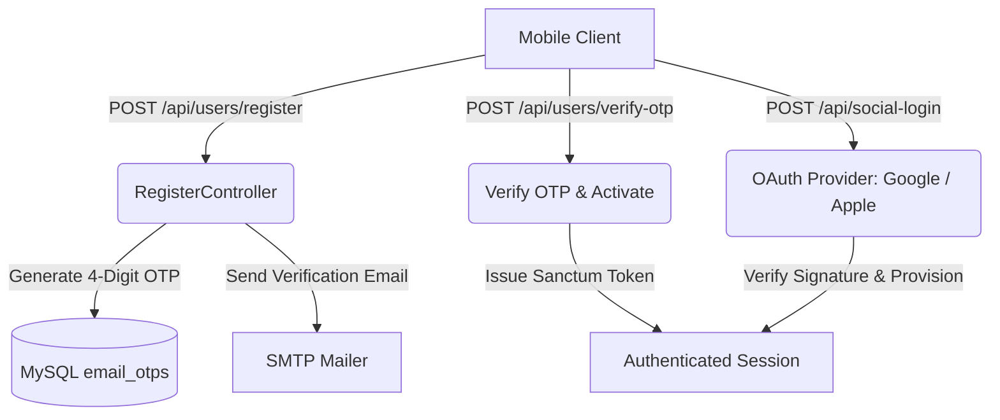
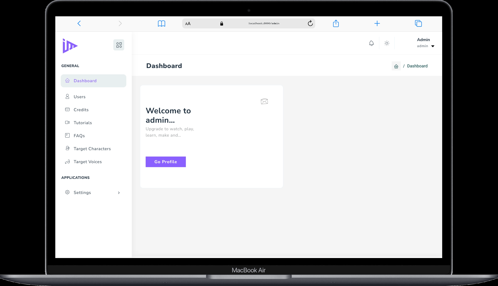
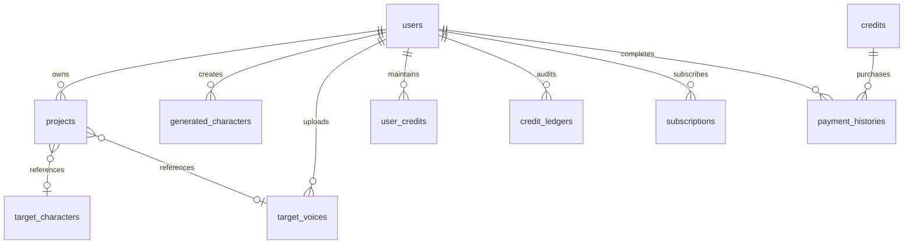

# Sinozia — AI-Powered Video Character Swap & Media Synthesis Backend

[](https://laravel.com)
[](https://www.php.net)
[](https://pestphp.com)
[](https://laravel.com/docs/pint)
[](LICENSE)

An enterprise-grade, asynchronous video transformation and generative AI backend built on Laravel 12. Sinozia powers a multi-platform mobile application that performs photorealistic character swaps, voice transformations, and custom avatar generations on user-submitted videos through a resilient job-chained pipeline.

---

## 1. Project Name

**Sinozia** — End-to-end asynchronous backend orchestration for AI character swap, multi-provider LLM vision synthesis, and real-time media processing.

---

## 2. Used Technologies

### Backend & Core Framework
- **PHP**: `^8.3`
- **Laravel Framework**: `^12.0` (Core application, queue orchestration, job chaining, events, Eloquent ORM)
- **Laravel Sanctum**: `^4.0` (Token-based mobile API authentication)
- **Symfony Process**: `^7.4` (Low-level execution of FFmpeg & FFprobe binary pipelines)

### Database & Storage
- **MySQL**: `8.0+` (Relational persistence: projects, characters, voices, credit ledger, subscriptions)
- **Redis / Predis**: `^3.4` (High-performance caching and queue driver support)
- **Laravel Public & Local Storage**: Abstracted filesystem for media assets, extracted frames, and video outputs

### Authentication & Authorization
- **Laravel Sanctum**: API token issuance and revocation
- **Socialite / Laravel Social Auth**: `^1.0` (OAuth2 authentication for Apple and Google mobile clients)
- **Role-Based Access Control**: Middleware enforcement for `admin` and `user` tiers

### External AI & Media Integrations
- **Kling AI API** (`kling-v2-6`): High-fidelity video motion synthesis and character animation
- **Google Gemini API** (`gemini-2.5-flash`): Multimodal vision analysis for frame comparison
- **OpenAI API** (`gpt-4o`, `gpt-image-2` / `dall-e-3`): Dual-role vision analysis and photorealistic character generation
- **Anthropic Claude API** (`claude-sonnet-4-20250514`): Pluggable vision comparison provider
- **NanaBanana API** (`gemini-3.1-flash-image-preview`): Fast preview image synthesis
- **ElevenLabs Speech-to-Speech API** (`eleven_english_sts_v2`): Voice cloning, speaker adaptation, and voice swap
- **FFmpeg & FFprobe**: Video demuxing, video frame extraction, audio stripping, and audio-video remuxing

### Billing & Monetization
- **Stripe PHP SDK**: `^20.1` (One-time credit purchase checkout sessions and fulfillment)
- **RevenueCat Webhooks**: Mobile in-app subscription lifecycle synchronization (Apple App Store & Google Play)

### Real-Time & WebSockets
- **Pusher PHP Server**: `^7.2` (WebSocket broadcasting for backend events)
- **Laravel Echo**: `^2.3.4` & **Pusher JS**: `^8.5.0` (Client-side real-time channel listeners)

### Frontend & Administrative Panel
- **Blade Components & Layouts**: Server-rendered administration dashboard
- **Tailwind CSS**: `^3.1.0` & `@tailwindcss/vite`: `^4.0.0`
- **Alpine.js**: `^3.4.2` (Reactive micro-interactions)
- **Vite**: `^7.0.7` (Asset bundling)
- **Yajra Datatables Oracle**: `12.0` (Server-side tabular data processing)
- **PHP Flasher**: `^2.2` (Flash messaging notification system)

### Testing & Code Quality
- **Pest PHP**: `^4.1` & **Pest Plugin Laravel**: `^4.0`
- **Laravel Pint**: `^1.24` (PHP CS Fixer code styling)

---

## 3. Project Overview

### The Problem
Generative video character replacement requires coordinated multimodal computation: isolating source video frames, analyzing visual discrepancies between source actor and target character, synthesizing a high-fidelity reference frame that preserves original lighting and background, queuing GPU-intensive video generation, and performing synchronized voice conversion. On consumer mobile connections, performing this synchronously is impossible due to timeouts, high resource consumption, and the need for user approval before charging compute credits.

### Target Users
- Mobile users seeking customized persona swaps on social media video clips.
- Digital creators and animators generating stylized AI character representations.
- Mobile application administrators managing character catalogs, voice profiles, user quotas, and system settings.

### Business Value
- **Pay-Per-Generation & Subscription Tiering:** Integrates both one-off credit bundle purchases (via Stripe) and monthly recurring memberships (via RevenueCat), automatically gating generation access based on plan quotas.
- **Fail-Safe Credit Accounting:** Deducts user credits only upon explicit confirmation of generated previews, with automated refunds on downstream pipeline failures.
- **Preview-First Confidence:** Generates a low-latency preview image allowing the user to validate the visual transformation before expending intensive video rendering resources.

### Technical Highlights
- **Resilient Chained Queue Pipeline:** Transformations are segmented into discrete, single-responsibility jobs (`ExtractVideoFrameJob` → `GenerateLLMPromptJob` → `GenerateNanoBananaPreviewJob` → `GenerateKlingVideoJob` → `PollKlingTaskJob` → `ProcessElevenLabsVoiceJob`), with independent timeout budgets, failure handlers, and automatic job recovery.
- **Multi-Driver LLM & Preview Fallbacks:** Decoupled LLM Vision contract allowing zero-code provider swaps between Gemini, OpenAI, and Anthropic, alongside automated fallback between OpenAI and Gemini for image synthesis.
- **Binary-Level Media Multiplexing:** Pure PHP-orchestrated FFmpeg processes with zero Python or secondary runtime dependencies for audio extraction, timestamp preservation, and codec synchronization.

---

## 4. System Architecture & Workflow

### Architectural Overview



### Core Transformation Pipeline Flow



### Authentication & Token Lifecycle



---

## 5. Key Functional Modules & Flows

### 1. AI Video Transformation Pipeline
- **Actor:** Authenticated Mobile User.
- **Workflow:**
  1. The user uploads a video (`.mp4`, `.mov`, `.avi`) and designates a character source: an admin catalog character (`target_character_id`), a custom AI-generated character (`generated_character_id`), or an ad-hoc image file.
  2. The user selects target transformation zones (`face`, `body`, `background`) and optional voice cloning (`voice_enabled` with `target_voice_id`).
  3. The backend executes `ExtractVideoFrameJob` via FFmpeg to isolate the first video frame.
  4. `GenerateLLMPromptJob` prompts multimodal vision models (`GeminiVisionProvider` / `OpenAIVisionProvider` / `AnthropicVisionProvider`) to construct an isolated, visual transformation prompt.
  5. `GenerateNanoBananaPreviewJob` renders a preliminary static transformation image using OpenAI (`gpt-image-2`) with automatic failover to NanaBanana (`gemini-3.1-flash-image-preview`).
  6. Upon completion, the backend broadcasts a `PreviewReady` WebSocket event to private channel `user.{id}`.
  7. The user reviews the preview on mobile and triggers `POST /api/projects/{id}/confirm`.
  8. `CreditService` validates the user's plan quota, deducting required credits.
  9. `GenerateKlingVideoJob` dispatches the generation task to Kling AI.
  10. `PollKlingTaskJob` monitors generation status with exponential backoff and safety net scheduled command `kling:poll-pending`.
  11. If voice swap is requested, `ProcessElevenLabsVoiceJob` demuxes audio with FFmpeg, processes speech-to-speech conversion through ElevenLabs, and remuxes audio and video tracks without transcoding losses.
  12. Broadcasts `ProjectCompleted` with asset URLs, or executes automatic credit refund upon `ProjectFailed`.

### 2. AI Character Generation Subsystem
- **Actor:** Authenticated Mobile User & Staff Admin.
- **Workflow:**
  1. Users configure physical and stylistic parameters: `gender`, `ethnicity`, `age`, `eye_color`, `build`, `style`, `expression`, and arbitrary textual modifications (`custom_modification`).
  2. `GeneratedCharacterService` constructs a photorealistic natural-language prompt.
  3. `GenerateAiCharacterJob` executes generative synthesis via OpenAI DALL-E-3 / NanaBanana.
  4. Once generated, the character appears in the user's personal character vault and can be supplied directly to `ProjectController` as `generated_character_id`.
  5. Users can iteratively refine generated characters via `POST /api/generated-characters/{id}/apply-modification`.

### 3. Catalog Management (Characters & Voices)
- **Actor:** System Administrator (Admin Dashboard) & Mobile Client (Read API).
- **Workflow:**
  1. Admins curate preset libraries of characters (`TargetCharacter`) with tags, categories, and high-resolution portraits.
  2. Admins curate voice profiles (`TargetVoice`) with reference audio samples and ElevenLabs voice IDs.
  3. Users can upload custom private voice clips (`POST /api/target-voices`) scoped to their user account.
  4. API endpoints transparently merge preset catalog entries with user-specific custom items.

### 4. Credit & Subscription Monetization
- **Actor:** Mobile User & Webhooks (Stripe / RevenueCat).
- **Workflow:**
  1. **Credit Packages:** Users purchase discrete credit packs through Stripe Checkout sessions (`POST /api/credits/purchase`). Upon completion, Stripe redirects to verification callbacks and provisions credits via `CreditService`.
  2. **In-App Subscriptions:** Mobile in-app purchases fire webhooks to `POST /api/revenuecat/webhook`. Handlers verify signature, deduplicate event IDs, resolve the subscriber user, and update membership status (`free`, `standard`, `pro`, `unlimited`).
  3. **Quota Enforcement:** `canGenerate()` checks whether the active plan permits generation and validates balance against `config/plans.php`.

### 5. Administration & System Management
- **Actor:** Super Admin & Staff.
- **Workflow:**
  1. Full management of system settings, application logos, support email, and social links.
  2. Dynamic CMS pages (`DynamicPage`) for Terms of Service, Privacy Policy, and About the App.
  3. FAQ and interactive onboarding tutorial video management.
  4. User account moderation, active status toggling, and data deletion workflows complying with App Store guidelines.
  5. Interactive Environment Configuration & Cache Clearing (`EnvSettingController`) for dynamic runtime adjustments.



---

## 6. Project Structure

```
sinozia/
├── app/
│   ├── Console/Commands/
│   │   └── PollPendingKlingTasks.php     # Scheduled recovery for stuck Kling jobs
│   ├── Events/
│   │   ├── GeneratedCharacterReady.php    # WebSocket broadcast when AI character is generated
│   │   ├── PreviewReady.php               # WebSocket broadcast when project preview is ready
│   │   ├── ProjectCompleted.php           # WebSocket broadcast when final video is ready
│   │   └── ProjectFailed.php              # WebSocket broadcast on unrecoverable error
│   ├── Helpers/
│   │   └── Helper.php                     # Global image upload, formatting & JSON helpers
│   ├── Http/
│   │   ├── Controllers/
│   │   │   ├── Api/
│   │   │   │   ├── Auth/                  # Login, Register, OTP verification & Social Auth
│   │   │   │   ├── CreditController.php   # Credit balance & pack listings
│   │   │   │   ├── CreditPurchaseController.php # Stripe checkout initialization & callbacks
│   │   │   │   ├── DynamicPageController.php # CMS pages API
│   │   │   │   ├── FaqController.php      # FAQ listings
│   │   │   │   ├── GeneratedCharacterController.php # User custom AI character creation
│   │   │   │   ├── ProjectController.php  # Main video character-swap pipeline controller
│   │   │   │   ├── RevenueCatWebhookController.php # Mobile in-app subscription handler
│   │   │   │   ├── TargetCharacterController.php # Character catalog
│   │   │   │   ├── TargetVoiceController.php     # Voice catalog & user voice uploads
│   │   │   │   ├── TutorialController.php # Tutorial video listings
│   │   │   │   └── UserController.php     # User profile, password & account deletion
│   │   │   ├── Web/
│   │   │   │   ├── Backend/               # Admin blade controllers (Users, CMS, Credits, etc.)
│   │   │   │   └── Frontend/              # Public web pages, legal policies & account deletion
│   │   ├── Middleware/
│   │   │   ├── AdminMiddleware.php        # Restricts access to admin dashboard
│   │   │   └── CheckUserEnabledMiddleware.php # Restricts deactivated users
│   │   └── Resources/                     # Eloquent API transformation resources
│   ├── Jobs/
│   │   ├── ExtractVideoFrameJob.php       # FFmpeg video frame 1 extraction
│   │   ├── GenerateAiCharacterJob.php     # Generates custom AI characters
│   │   ├── GenerateKlingVideoJob.php      # Submits task to Kling AI
│   │   ├── GenerateLLMPromptJob.php       # LLM vision comparison prompt builder
│   │   ├── GenerateNanoBananaPreviewJob.php # Synthesis of preview transformation image
│   │   ├── PollKlingTaskJob.php           # Recursive 30s status polling worker
│   │   ├── ProcessElevenLabsVoiceJob.php  # ElevenLabs speech-to-speech audio replacement
│   │   └── RefreshMonthlyCreditsJob.php   # Monthly quota refresh worker
│   ├── Models/                            # Eloquent entities & relationship definitions
│   └── Services/
│       ├── CreditService.php              # Quota validation, deduction & ledger audit
│       ├── ElevenLabsService.php          # Speech-to-speech & audio extraction pipeline
│       ├── GeneratedCharacterService.php  # Attribute prompt builder & DALL-E/NanaBanana synthesis
│       ├── GptImageService.php            # Dual-driver image synthesis with auto-fallback
│       ├── KlingService.php               # Kling AI API client with JWT generation
│       ├── NanaBananaService.php          # Gemini image synthesis client
│       ├── StripeService.php              # Stripe Checkout session manager
│       └── LLM/
│           ├── Contracts/LLMVisionContract.php
│           ├── Providers/                 # GeminiVisionProvider, OpenAIVisionProvider, AnthropicVisionProvider
│           └── SystemPromptService.php    # Granular prompt builder for face/body/background swap
├── config/                                # Modular application & third-party service configs
├── database/
│   ├── migrations/                        # Relational schema definitions
│   └── seeders/                           # Initial catalog & demo seeders
├── docs/
│   └── DEPLOYMENT.md                      # Production deployment & CI/CD guide
├── routes/
│   ├── api.php                            # Public and authenticated mobile REST APIs
│   ├── rahat_api.php                      # Project pipeline & character generation routes
│   ├── backend.php                        # Admin management panel routes
│   ├── admin_setting.php                  # System configuration routes
│   ├── channels.php                       # Private WebSocket authorization rules
│   ├── frontend.php                       # Public frontend web routes
│   └── web.php                            # Web authentication routes
└── tests/                                 # Feature & Unit Pest testing suite
```

---

### Complete API Reference

#### 1. Authentication & User Onboarding

| Method | Endpoint | Auth / Middleware | Description | Request Payload / Params | Response Structure |
|---|---|---|---|---|---|
| `POST` | `/api/users/register` | Public (Throttle: 5,1) | Register a new user account and trigger verification OTP | `name`, `email`, `password`, `password_confirmation` | `{success, message, data: {user}}` |
| `POST` | `/api/users/resend-otp` | Public (Throttle: 5,1) | Re-generate and resend registration OTP email | `email` | `{success, message}` |
| `POST` | `/api/users/verify-otp` | Public (Throttle: 5,1) | Validate 4-digit OTP, verify email, and issue Sanctum token | `email`, `otp` | `{success, message, data: {user, token}}` |
| `POST` | `/api/users/login` | Public (Throttle: 5,1) | Authenticate user credentials and return Sanctum token | `email`, `password` | `{success, message, data: {user, token}}` |
| `POST` | `/api/users/email-verify` | Public (Throttle: 5,1) | Send password-reset OTP to email address | `email` | `{success, message}` |
| `POST` | `/api/users/otp-resend` | Public (Throttle: 5,1) | Resend password-reset OTP | `email` | `{success, message}` |
| `POST` | `/api/users/otp-verify` | Public (Throttle: 5,1) | Verify password-reset OTP code | `email`, `otp` | `{success, message, data: {user}}` |
| `POST` | `/api/users/reset-password` | Public (Throttle: 5,1) | Reset password with verified reset token | `email`, `password`, `password_confirmation` | `{success, message}` |
| `POST` | `/api/social-login` | Public | Mobile OAuth login via Google or Apple identity tokens | `provider` (`google` \| `apple`), `token` \| `code`, `device` (`android` \| `ios`) | `{success, token, user}` |

#### 2. User Profile & Account Management

| Method | Endpoint | Auth / Middleware | Description | Request Payload / Params | Response Structure |
|---|---|---|---|---|---|
| `GET` | `/api/user/profile` | `auth:sanctum`, `enabled` | Retrieve authenticated user profile with credits | None | `{success, data: {id, name, email, credits, ...}}` |
| `POST` | `/api/user/update-profile`| `auth:sanctum`, `enabled` | Update user name and avatar image | `name`, `avatar` (file, optional) | `{success, message, data: {user}}` |
| `POST` | `/api/user/change-password`| `auth:sanctum`, `enabled` | Change user password | `current_password`, `password`, `password_confirmation` | `{success, message}` |
| `POST` | `/api/user/logout` | `auth:sanctum`, `enabled` | Revoke current access token | None | `{success, message}` |
| `DELETE`| `/api/user/delete-account`| `auth:sanctum`, `enabled` | Permanently delete user account and uploaded media | None | `{success, message}` |

#### 3. AI Video Transformation Pipeline

| Method | Endpoint | Auth / Middleware | Description | Request Payload / Params | Response Structure |
|---|---|---|---|---|---|
| `GET` | `/api/projects` | `auth:sanctum`, `enabled` | List user projects with pagination and status filters | Query: `status` (`pending`, `completed`, `all`), `per_page` | `{success, data: [{project}], meta}` |
| `POST` | `/api/projects` | `auth:sanctum`, `enabled` | Create new transformation project and start pipeline | `video` (file), `target_character` (file, optional), `target_character_id` (optional), `generated_character_id` (optional), `target_voice_id` (optional), `transformation_type[]` (`face`, `body`, `background`), `voice_enabled` (boolean), `quality` (`std` \| `pro`) | `{success, data: {project_id, status}}` |
| `GET` | `/api/projects/{project}` | `auth:sanctum`, `enabled` | Fetch project details, preview image, and final video | None | `{success, data: {ProjectResource}}` |
| `POST` | `/api/projects/{project}/update` | `auth:sanctum`, `enabled` | Update project character, voice, or swap settings and restart preview | `target_character`, `target_character_id`, `generated_character_id`, `target_voice_id`, `transformation_type[]`, `voice_enabled`, `quality` | `{success, data: {ProjectResource}}` |
| `POST` | `/api/projects/{project}/confirm` | `auth:sanctum`, `enabled` | Confirm validated preview, deduct credits, and trigger Kling video generation | None | `{success, data: {message, credits_deducted, credits_remaining}}` |

#### 4. AI Generated Characters (Custom Persona Vault)

| Method | Endpoint | Auth / Middleware | Description | Request Payload / Params | Response Structure |
|---|---|---|---|---|---|
| `GET` | `/api/generated-characters` | `auth:sanctum`, `enabled` | List completed AI characters created by the user | Query: `per_page` | `{success, data: [{GeneratedCharacter}], meta}` |
| `POST` | `/api/generated-characters` | `auth:sanctum`, `enabled` | Generate new character using parametric attributes | `title`, `age`, `gender` (`male` \| `female`), `ethnicity`, `eye_color`, `build`, `style`, `expression`, `custom_modification` | `{success, data: {id, status}}` |
| `GET` | `/api/generated-characters/{id}` | `auth:sanctum`, `enabled` | View single generated character details | None | `{success, data: {GeneratedCharacterResource}}` |
| `POST` | `/api/generated-characters/{id}/apply-modification` | `auth:sanctum`, `enabled` | Apply additional prompt modifications and re-render | `custom_modification` (string) | `{success, data: {GeneratedCharacterResource}}` |
| `DELETE`| `/api/generated-characters/{id}` | `auth:sanctum`, `enabled` | Delete generated character and clean disk storage | None | `{success, message}` |

#### 5. Preset Catalogs (Characters & Voices)

| Method | Endpoint | Auth / Middleware | Description | Request Payload / Params | Response Structure |
|---|---|---|---|---|---|
| `GET` | `/api/target-characters` | Public / Sanctum optional | List catalog preset characters and user generated characters | Query: `page`, `per_page` | `{success, data: [{character}], meta}` |
| `GET` | `/api/target-characters/{id}`| Public / Sanctum optional | Show single preset or generated character | None | `{success, data: {TargetCharacterResource}}` |
| `GET` | `/api/target-voices` | `auth:sanctum`, `enabled` | List available public voices and user-uploaded custom voices | Query: `per_page` | `{success, data: [{voice}], meta}` |
| `POST` | `/api/target-voices` | `auth:sanctum`, `enabled` | Upload a new custom reference voice clip | `title`, `audio` (file: mp3, wav, ogg, m4a, max 100MB) | `{success, data: {TargetVoiceResource}}` |
| `GET` | `/api/target-voices/{id}` | `auth:sanctum`, `enabled` | Get single voice clip details | None | `{success, data: {TargetVoiceResource}}` |
| `PUT` | `/api/target-voices/{id}` | `auth:sanctum`, `enabled` | Update user custom voice title or replace audio file | `title`, `audio` (file, optional) | `{success, data: {TargetVoiceResource}}` |
| `DELETE`| `/api/target-voices/{id}` | `auth:sanctum`, `enabled` | Delete custom user voice | None | `{success, message}` |

#### 6. Credits & Monetization

| Method | Endpoint | Auth / Middleware | Description | Request Payload / Params | Response Structure |
|---|---|---|---|---|---|
| `GET` | `/api/credit` | `auth:sanctum`, `enabled` | List available purchase credit packages | None | `{success, data: [{CreditPackage}]}` |
| `GET` | `/api/credits/balance` | `auth:sanctum`, `enabled` | View current credit balance, plan type, and generation eligibility | None | `{success, data: {balance, plan_type, is_premium, can_generate, video_cost}}` |
| `GET` | `/api/credits/history` | `auth:sanctum`, `enabled` | Retrieve credit ledger transaction history | None | `{success, data: [{CreditLedger}]}` |
| `POST` | `/api/credits/purchase` | `auth:sanctum`, `enabled` | Initialize Stripe Checkout session for credit package | `id` (credit package ID) | `{success, url}` |
| `GET` | `/api/purchase-success` | Public | Stripe redirect callback upon successful payment | Query: `session_id` | Redirects to success page |
| `GET` | `/api/purchase-cancel` | Public | Stripe redirect callback upon cancelled payment | Query: `redirect_url` (optional) | Redirects to cancel page |
| `POST` | `/api/revenuecat/webhook`| Public (CSRF excluded) | Process mobile subscription lifecycle events | RevenueCat JSON payload | `{success, message}` |

#### 7. Dynamic Content, Support & System Settings

| Method | Endpoint | Auth / Middleware | Description | Request Payload / Params | Response Structure |
|---|---|---|---|---|---|
| `GET` | `/api/dynamic-pages` | Public | List active CMS dynamic pages | None | `{success, data: [{DynamicPage}]}` |
| `GET` | `/api/dynamic-pages/{slug}`| Public | Fetch single CMS dynamic page content | Slug parameter | `{success, data: {DynamicPage}}` |
| `GET` | `/api/faqs` | Public | List active FAQs | None | `{success, data: [{Faq}]}` |
| `GET` | `/api/tutorials` | Public | List app onboarding tutorials | None | `{success, data: [{Tutorial}]}` |
| `GET` | `/api/tutorials/{id}` | Public | Fetch tutorial video details | ID parameter | `{success, data: {Tutorial}}` |
| `GET` | `/api/system-settings` | Public | Retrieve public system settings (branding, logo) | None | `{success, data: {SystemSetting}}` |
| `GET` | `/api/social-media` | Public | Retrieve official social media channel links | None | `{success, data: [{SocialMedia}]}` |

#### 8. Administrative Web Management Endpoints

| Method | Endpoint | Auth / Middleware | Description |
|---|---|---|---|
| `GET` | `/admin/dashboard` | `web`, `auth`, `admin` | Main administrative overview metrics and pipeline statistics |
| `GET` / `PATCH` | `/admin/users` | `web`, `auth`, `admin` | User management, Yajra DataTables, account deactivation/activation |
| `CRUD` | `/admin/target-characters` | `web`, `auth`, `admin` | Curated preset character library creation, tag editing, image management |
| `CRUD` | `/admin/target-voices` | `web`, `auth`, `admin` | Voice profile management, reference audio sample uploads |
| `CRUD` | `/admin/credits` | `web`, `auth`, `admin` | Credit pricing bundle configuration, featured/popular tier toggles |
| `GET` / `DELETE` | `/admin/generated-characters` | `web`, `auth`, `admin` | Moderation queue for user-generated AI characters |
| `CRUD` | `/admin/faqs` | `web`, `auth`, `admin` | Frequently asked questions management |
| `CRUD` | `/admin/tutorials` | `web`, `auth`, `admin` | Onboarding video tutorials and thumbnail uploads |
| `CRUD` | `/admin/dynamic-page` | `web`, `auth`, `admin` | Terms of Service, Privacy Policy, and About the App rich-text CMS |
| `GET` / `POST` | `/admin/system-setting` | `web`, `auth`, `admin` | Branding, logo, favicon, and contact email configuration |
| `GET` / `POST` | `/admin/mail-setting` | `web`, `auth`, `admin` | SMTP credentials and outbound sender configuration |
| `GET` / `POST` | `/admin/env-setting` | `web`, `auth`, `admin` | Interactive runtime environment management & application cache clearing |

---

### Database Schema & Entities

The persistence layer comprises 14 primary relational tables designed for multi-tenant isolation and transactional integrity:



1. **`users`**: User records, credentials, social authentication IDs (`google_id`, `apple_id`), subscription tier (`plan_type`: `free`, `standard`, `pro`, `unlimited`), premium status (`is_premium`), role (`admin`, `user`), and activation state.
2. **`projects`**: Central video transformation entity containing video input path, extracted frame path, target character path, transformation mode (`face`, `body`, `background`), quality (`std`, `pro`), voice flags, status tracking (`pending`, `awaiting_user_validation`, `generating_video`, `completed`, `failed`), Kling task ID, and final generated output URLs.
3. **`generated_characters`**: User-generated custom AI characters tracking physical traits (`age`, `gender`, `ethnicity`, `eye_color`, `build`, `style`, `expression`), user prompt modifications, synthesized image paths, and generation status.
4. **`target_characters`**: Curated preset character library with display titles, categorization tags, and portrait assets.
5. **`target_voices`**: System preset and user-uploaded reference audio tracks with ElevenLabs voice identifiers.
6. **`user_credits` & `credit_ledgers`**: Current spendable credit balance and append-only audit trail logging credit inflows (Stripe purchases, plan refreshes) and outflows (video generation deductions).
7. **`subscriptions` & `revenue_cat_events`**: Subscription tier history, entitlement expiration dates, and idempotent audit log of incoming mobile store webhook events.
8. **`credits` & `payment_histories`**: Credit bundle catalog (credits count, price, currency) and transactional checkout history.
9. **`dynamic_pages`, `faqs`, `tutorials`, `system_settings`, `social_media`**: Content management and administrative configuration tables.

---

## 7. Environment Configuration (.env)

The application provides a comprehensive `.env.example` template. Configure your local `.env` with the following variables:

| Variable | Purpose | Example Placeholder |
|---|---|---|
| `APP_NAME` | Name of the application | `Sinozia` |
| `APP_ENV` | Application environment | `local` / `production` |
| `APP_KEY` | 32-character encryption key | Generate via `php artisan key:generate` |
| `APP_DEBUG` | Enable debug backtraces | `true` (local) / `false` (production) |
| `APP_URL` | Base application URL | `http://localhost:8000` |
| `DB_CONNECTION` | Database driver | `mysql` |
| `DB_HOST` | Database host | `127.0.0.1` |
| `DB_PORT` | Database port | `3306` |
| `DB_DATABASE` | Database name | `sinozia_db` |
| `DB_USERNAME` | Database username | `root` |
| `DB_PASSWORD` | Database password | `secret` |
| `QUEUE_CONNECTION` | Queue driver | `database` / `redis` |
| `CACHE_STORE` | Cache driver | `database` / `redis` |
| `MAIL_MAILER` | Outbound mailer | `smtp` |
| `MAIL_HOST` | SMTP server host | `smtp.mailtrap.io` |
| `MAIL_PORT` | SMTP server port | `2525` |
| `MAIL_USERNAME` | SMTP account username | `your_smtp_username` |
| `MAIL_PASSWORD` | SMTP account password | `your_smtp_password` |
| `BROADCAST_CONNECTION` | Real-time broadcast driver | `pusher` |
| `PUSHER_APP_ID` | Pusher application ID | `your_pusher_app_id` |
| `PUSHER_APP_KEY` | Pusher public application key | `your_pusher_app_key` |
| `PUSHER_APP_SECRET` | Pusher private secret key | `your_pusher_app_secret` |
| `PUSHER_APP_CLUSTER` | Pusher cluster identifier | `mt1` |
| `LLM_PROVIDER` | LLM vision provider driver | `gemini` / `openai` / `anthropic` |
| `GEMINI_API_KEY` | Google Gemini API key | `your_gemini_api_key` |
| `OPENAI_API_KEY` | OpenAI API key | `your_openai_api_key` |
| `ANTHROPIC_API_KEY` | Anthropic Claude API key | `your_anthropic_api_key` |
| `IMAGE_PREVIEW_DRIVER` | Preview generation driver | `openai` / `nanobanana` |
| `NANOBANANA_API_KEY` | NanaBanana image preview API key | `your_nanobanana_api_key` |
| `KLING_ACCESS_KEY` | Kling AI Access Key | `your_kling_access_key` |
| `KLING_SECRET_KEY` | Kling AI Secret Key | `your_kling_secret_key` |
| `ELEVENLABS_API_KEY` | ElevenLabs API key | `your_elevenlabs_api_key` |
| `FFMPEG_PATH` | Path to FFmpeg binary executable | `/usr/bin/ffmpeg` or `C:\\ffmpeg\\bin\\ffmpeg.exe` |
| `FFPROBE_PATH` | Path to FFprobe binary executable | `/usr/bin/ffprobe` or `C:\\ffmpeg\\bin\\ffprobe.exe` |
| `STRIPE_PUBLIC_KEY` | Stripe publishable key | `pk_test_placeholder_key` |
| `STRIPE_SECRET_KEY` | Stripe secret key | `sk_test_placeholder_key` |
| `REVENUECAT_WEBHOOK_SECRET` | In-app purchase webhook secret | `your_revenuecat_webhook_secret` |
| `CLIENT_ID_ANDROID` | Google OAuth Android client ID | `your_android_client_id.apps.googleusercontent.com` |
| `CLIENT_ID_IOS` | Google OAuth iOS client ID | `your_ios_client_id.apps.googleusercontent.com` |

---

## 8. Installation & Setup Commands

### Prerequisites
- PHP `^8.3` with extensions: `pdo_mysql`, `mbstring`, `bcmath`, `xml`, `ctype`, `curl`, `redis`
- Composer `^2.5`
- Node.js `^20.0` & NPM
- MySQL `^8.0`
- FFmpeg & FFprobe installed and available in system PATH

### Step-by-Step Installation

```bash
# 1. Clone repository
git clone https://github.com/imtiaz-ahamed-hridoy/Sinozia.git
cd Sinozia

# 2. Install PHP dependencies
composer install

# 3. Install JavaScript dependencies
npm install

# 4. Initialize environment configuration
cp .env.example .env
php artisan key:generate

# 5. Configure database credentials in .env, then run migrations and seeders
php artisan migrate --seed

# 6. Create symbolic link for public media storage
php artisan storage:link

# 7. Compile frontend assets
npm run build
```

### FFmpeg Setup
- **Linux (Ubuntu/Debian):**
  ```bash
  sudo apt update && sudo apt install -y ffmpeg
  ```
- **Windows:** Download the essentials build from [gyan.dev](https://www.gyan.dev/ffmpeg/builds/), extract to `C:\ffmpeg`, add `C:\ffmpeg\bin` to your system `PATH`, and verify with `ffmpeg -version`. Refer to [ffmpeg.md](ffmpeg.md) for detailed step-by-step instructions.

---

## 9. Running the Application

### 1. Unified Development Mode (Concurrent)
Run the HTTP server, queue listener, and Vite compiler simultaneously:
```bash
composer run dev
```

### 2. Manual Process Management
Run individual services in dedicated terminal tabs:

```bash
# Terminal 1: Laravel Web Server
php artisan serve --port=8000

# Terminal 2: Queue Worker (Processes asynchronous FFmpeg, LLM, and Kling jobs)
php artisan queue:work database --timeout=300 --tries=3 --sleep=3 --memory=512

# Terminal 3: Vite Dev Server
npm run dev
```

### 3. Task Scheduler Daemon (Cron)
In production, run the schedule worker:
```bash
php artisan schedule:work
```

### Sample API Execution (cURL with Placeholder Token)

```bash
# 1. Fetch User Profile & Credit Balance
curl -X GET http://localhost:8000/api/user/profile \
  -H "Authorization: Bearer YOUR_SANCTUM_TOKEN" \
  -H "Accept: application/json"

# 2. Create Video Transformation Project
curl -X POST http://localhost:8000/api/projects \
  -H "Authorization: Bearer YOUR_SANCTUM_TOKEN" \
  -H "Accept: application/json" \
  -F "video=@/path/to/source_video.mp4" \
  -F "target_character_id=1" \
  -F "transformation_type[]=face" \
  -F "voice_enabled=false" \
  -F "quality=pro"

# 3. Confirm Generated Preview & Start Video Synthesis
curl -X POST http://localhost:8000/api/projects/1/confirm \
  -H "Authorization: Bearer YOUR_SANCTUM_TOKEN" \
  -H "Accept: application/json"
```

---

## 10. Testing & Code Quality

### Running the Test Suite
The project utilizes Pest PHP for automated feature and unit testing:

```bash
# Run all automated tests
php artisan test

# Alternatively using Pest directly
./vendor/bin/pest
```

The test suite covers:
- User registration, OTP generation, and email verification
- User profile updates, authentication guards, and password change API security
- Password reset, confirmation, and security workflows
- Credit balance retrieval, plan entitlement checks, and paginated transaction history
- Target Voice audio uploads, multi-tenant isolation, and personal/global catalog filtering
- Generated AI Character API access, parametric creation, authorization isolation, and deletion
- Video transformation Project lifecycle, authorization gating, validation rules, and credit confirmation
- Dynamic CMS pages, FAQs, onboarding tutorials, and system setting endpoints

### Code Style & Formatting
Enforce PSR-12 and Laravel Pint style standards:
```bash
./vendor/bin/pint --test
./vendor/bin/pint
```

---

## 11. CI/CD & Deployment

Automated deployments are governed by GitHub Actions workflows targeting production Linux VPS instances via SSH and SCP. The pipeline performs automated dependency caching, asset compilation, zero-downtime database migrations, configuration caching, and queue worker restarts.

For full architectural diagrams, server provisioning steps, Supervisor worker templates, and required GitHub secret configurations, refer to the [Production Deployment & CI/CD Guide](docs/DEPLOYMENT.md).

---

## 12. My Role & Contributions

**Author / Contributor:** [Imtiaz Ahamed Hridoy](https://github.com/imtiaz-ahamed-hridoy)

As part of the engineering team on this project, my core contributions included:
- **AI Character Generation Architecture:** Designed and implemented the complete AI Character Generation module (`GeneratedCharacter` model, database migrations, `GeneratedCharacterService`, `GenerateAiCharacterJob`, and `GeneratedCharacterReady` broadcast event), enabling users to generate custom photorealistic characters via parameterized physical traits.
- **Pipeline Integration:** Extended the core `ProjectController` transformation pipeline to seamlessly accept and resolve AI-generated characters alongside catalog presets and direct uploads.
- **Multi-Tenant Security & API Scoping:** Audited and resolved user ID resolution across transformation routes to enforce strict authorization checks preventing cross-tenant access.
- **Production Asset Compilation & Blade Stabilization:** Fixed Blade component compiler dependencies (`input-label`, `text-input`) resolving view cache optimization failures during production deployments.
- **Queue Pipeline Reliability:** Debugged character UUID resolution into standardized sequential foreign keys across background workers and API responses.

---

## 13. Showcase Disclaimer

> [!NOTE]
> This repository is a sanitized portfolio showcase of a client project, published with the client's explicit permission. All live infrastructure credentials, private API keys, production database records, deployment IP addresses, internal domains, and customer uploads have been scrubbed or replaced with generic placeholders. All features and API endpoints documented above are implemented in the codebase.
