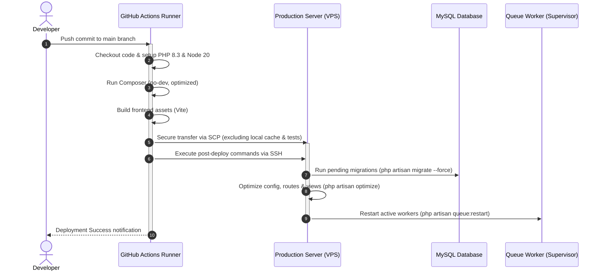

# Production Deployment & CI/CD Guide

This document describes the deployment architecture and continuous delivery pipeline for Sinozia, outlining secure release procedures, required GitHub Actions configurations, server environment preparations, and operational maintenance.

---

## 1. Deployment Architecture & Pipeline Flow

The project utilizes automated GitHub Actions workflows triggered on pushes to the `main` branch or manual invocation (`workflow_dispatch`). The workflow performs dependency installation, asset compilation, secure transport to the server, database migrations, and application cache optimization.



---

## 2. GitHub Actions Secrets & Variables

To enable automated deployment without exposing infrastructure details in source control, configure the following parameters in your GitHub repository (**Settings > Secrets and variables > Actions**).

### Required Secrets (`Actions Secrets`)

| Name | Type | Purpose | Example Placeholder |
|---|---|---|---|
| `SSH_HOST` | Secret | Production server IP address or domain | `203.0.113.10` |
| `SSH_USER` | Secret | Dedicated non-root deployment user | `deployer` |
| `SSH_PORT` | Secret | Server SSH port | `22` |
| `SSH_PRIVATE_KEY` | Secret | Private SSH key for server authentication | `your_openssh_private_key_content` |
| `SSH_KNOWN_HOSTS` | Secret | Public key fingerprints of target host | `ssh-ed25519 AAAAC3NzaC1lZDI1NTE5...` |

### Required Variables (`Actions Variables`)

| Name | Type | Purpose | Example Placeholder |
|---|---|---|---|
| `DEPLOY_PATH` | Variable | Root filesystem path of the application | `/path/to/application` |
| `PHP_VERSION` | Variable | PHP runtime version | `8.3` |
| `NODE_VERSION` | Variable | Node.js runtime version for Vite | `20` |

---

## 3. Server Preparation & Key Setup

### A. Dedicated Deployment User
Never deploy using the `root` account. Create a dedicated deploy user with restricted privileges:

```bash
# Create deploy user
sudo adduser --disabled-password --gecos "" deployer

# Grant ownership of deployment directory
sudo mkdir -p "${DEPLOY_PATH}"
sudo chown -R deployer:www-data "${DEPLOY_PATH}"
sudo chmod -R 775 "${DEPLOY_PATH}/storage" "${DEPLOY_PATH}/bootstrap/cache"
```

### B. Generate Deployment SSH Key
Generate a secure Ed25519 key pair on your administrative workstation:

```bash
ssh-keygen -t ed25519 -C "github-actions-deploy" -f ./deploy_key -N ""
```

1. Copy the public key (`deploy_key.pub`) to the server:
   ```bash
   cat deploy_key.pub | ssh user@your-server-ip "sudo -u deployer tee -a ~deployer/.ssh/authorized_keys"
   ```
2. Store the contents of the private key (`deploy_key`) as the `SSH_PRIVATE_KEY` repository secret.
3. Retrieve host keys for `SSH_KNOWN_HOSTS`:
   ```bash
   ssh-keyscan -p 22 -H your-server-ip
   ```

---

## 4. Daemon & Process Management (Supervisor)

The application depends on background queue workers for FFmpeg video extraction, LLM vision prompt generation, Kling AI synthesis polling, and ElevenLabs speech processing.

Create `/etc/supervisor/conf.d/sinozia_worker.conf`:

```ini
[program:sinozia_worker]
process_name=%(program_name)s_%(process_num)02d
command=php %(ENV_DEPLOY_PATH)s/artisan queue:work database --sleep=3 --tries=3 --timeout=300 --memory=512
autostart=true
autorestart=true
user=deployer
numprocs=2
redirect_stderr=true
stdout_logfile=%(ENV_DEPLOY_PATH)s/storage/logs/worker.log
stopwaitsecs=3600
```

Apply Supervisor configuration:
```bash
sudo supervisorctl reread
sudo supervisorctl update
sudo supervisorctl start sinozia_worker:*
```

---

## 5. Scheduled Tasks (Cron)

Ensure Laravel's scheduled task runner (such as the Kling pending task health poller) runs every minute:

```bash
# Open crontab for deployer user
crontab -u deployer -e

# Add Laravel schedule worker
* * * * * cd /path/to/application && php artisan schedule:run >> /dev/null 2>&1
```

---

## 6. Security & Hardening Recommendations

1. **Principle of Least Privilege:** Ensure the deployment SSH key only has access to the application deployment directory and is locked down with restrictive file permissions (`chmod 600 ~/.ssh/authorized_keys`).
2. **Environment Isolation:** Maintain the production `.env` file directly on the target host or inject it during automated deployment via GitHub Environment Secrets; never commit `.env` into git.
3. **Key Rotation Policy:** Rotate SSH keys and external API credentials every 90 days.
4. **Environment Protection Rules:** Configure GitHub repository environments (`production`) with required pull request reviews and branch protection rules on `main`.

